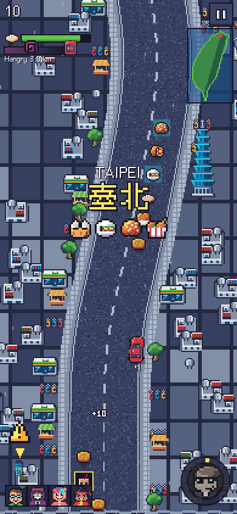

# Taiwan Treats Trip 吃飽逃颱

**Play:** https://www.calebjay.com/games/taiwan-treats-trip/ (phone-first; it also works on desktop)

A pixel-art road-trip game through Taiwan. Drive winding mountain roads, choose your route at every fork, and eat as many Taiwanese snacks as you can before **Typhoon Hangry 颱風餓餓** catches you.

 

## Why

My friends and I were having a bit of a contest to see who could generate the most fun game on our road trip, pitting our LLM harness and agent setups against each other. I think mine is pretty fun, so I'm open sourcing it so anyone can play with it or modify it for their friends.

## How it plays

- **Steering:** drag anywhere to steer (arrow keys or A/D on desktop). Steer into a branch at each fork.
- **Signs:** each fork's road signs hint at what's down each branch: snack amount, the regional specialty, and a 🌀 if one of Hangry's storm arms is there.
- **Belly meter:** snacks fill it, and it is your speed. Combos multiply your score.
- **Hazards:** hits never end the run, they just slow you down and spill snacks. Watch for scooter swarms, falling rocks, tour buses, macaques that steal snacks, and blue trucks 藍色小貨車 that come up from behind (warning sign on that side of the screen).
- **Regions:** eight of them (Taipei, Taichung, Wuling Farm, Jiufen, Taroko Gorge, Hualien, Taitung, Kaohsiung), each with its own snacks, scenery and landmark. The run is endless around the island.
- **Crew:** pick a leader. Each friend has an ability that charges as you eat: a drone, a typhoon hack, slow-motion, turning hazards into snacks, and a kung fu dash.
- **Vehicles:** a hatchback (one life), or a scooter squad where Hangry eats the scooter at the back first.
- **Extras:** a snack log 圖鑑 that remembers everything you've eaten, a share button, and the UI in English or 中文.

## Make it yours

Everything ships as one self-contained file, `games/taiwan-treats-trip/index.html`: vanilla Canvas 2D, no libraries, no network once loaded. It is built from this folder:

| path | what |
|---|---|
| `src/1_head.html` | markup and CSS |
| `src/2_data.js` | snacks, regions, the crew, save data. **Start here to swap in your own friends, places and food.** |
| `src/2b_zh.js`, `src/2c_i18n.js` | Mandarin text and all UI strings |
| `src/3_gfx.js` … `src/7_ui.js` | sprites and sound, world generation, simulation, rendering, UI |
| `art/*.js` | pixel art as text grids, one palette character per pixel (`art/palette.json`) |
| `tools/` | build, preview and test scripts |
| `PROGRESS.md` | design notes, status, and a handoff guide for agents |

```sh
python3 tools/build.py                 # src + art + font subset -> games/taiwan-treats-trip/index.html
python3 tools/preview.py art/snacks.js # render a sprite sheet PNG and validate the grids
cd tools && npm install                # playwright-core, for the headless tests below
node tools/shot.js                     # headless Chromium smoke test + screenshots (needs /usr/bin/chromium)
node tools/sim.js 8 .8 car             # autopilot balance simulation
```

Requirements: Python 3 with `fonttools` and `brotli`; Pillow for `preview.py`; Node for the tests. Edit `src/` and rebuild; don't edit `index.html` by hand.

## Credits and license

- Made by [Caleb Rogers](https://www.calebjay.com) with AI agents (Claude and GPT) for code, pixel art and synthesized sound, for a 2026 road trip with Jeremy, Riley, Lauren and Rachel.
- Caleb builds software with [508.dev](https://508.dev), an engineering co-op, and **we're looking for engineers**.
- Code and art: **GPL-3.0-or-later** (see `LICENSE`).
- Font: [Cubic 11 俐方體11號](https://github.com/ACh-K/Cubic-11), SIL Open Font License 1.1, subset and embedded with added pinyin tone vowels (`font/OFL.txt`).
